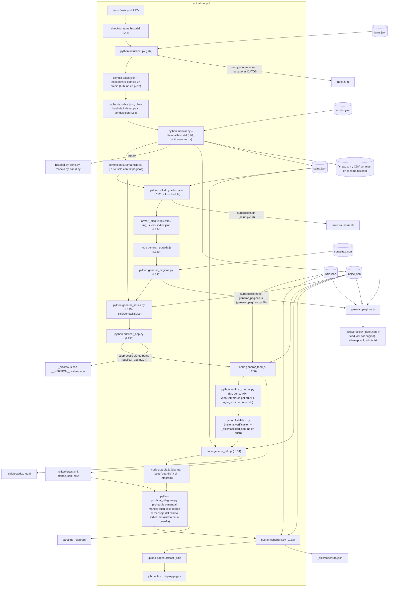

# Mapa del repo

Para que una sesion nueva entienda La Pichincha sin perder el hilo: **que corre, en que orden, que archivo
es dueño de que y que tocar para cada cambio comun**. Verificado contra el codigo el 16/10/2026; las
referencias `archivo:linea` son de esa fecha. El **por que** de cada pieza esta en el [README](../README.md)
y el **como se trabaja** en [proceso-de-trabajo.md](proceso-de-trabajo.md): aca solo se enlazan.

Este mapa existe porque el grafo de codigo no ve el pegamento de este repo (workflow YAML, JSON de
configuracion, llamadas por `subprocess`): ver [proceso-de-trabajo.md, seccion 3.2](proceso-de-trabajo.md#32-graphify-medido-el-16102026-no-se-adopta).

## 1. El flujo de una publicacion

`.github/workflows/actualizar.yml` corre todos los dias a las 12:00 UTC (L9), a mano (`workflow_dispatch`,
L10) y en cada push a `main` que no sea solo `.md` (L19). Los pasos van en este orden; los que terminan
en `|| echo "::warning::..."` no voltean la publicacion si fallan.



Puntos que no se ven en el codigo Python ni JS:

- **`indice.json` no esta en git.** Lo arma `indexar.py` (escribe en `indexar.py:520`) y viaja directo a
  `_sitio/`. Si la fuente falla, se publica el de la cache (L84-91). En un push a `main` solo se rearma
  si no hay cache (L95-98).
- **El historial vive en la rama huerfana `historial`**: un CSV por mes y `fichas.json` (`indexar.py:50`).
  Se trae con un segundo checkout (L47) y se commitea desde ese directorio (L104). Ahi tambien
  `verificacion/AAAA-MM.csv`: una fila por comercio y dia con lo que reviso la verificacion de ofertas
  (`fiabilidad.py`), que se commitea en su propio paso despues de la segunda verificacion.
- **Las series del grafico (D2) no viajan en el indice**: `generar_series.py` (L182) lee el historial ya commiteado y el
  indice final, y deja `_sitio/series/NN.json` en 64 fragmentos; la pagina baja solo el de un aviso cuando se abre su
  historial (`js/vista-historial.js`).
- **Tres llamadas por `subprocess`**: `generar_paginas.py:89` corre `node generar_paginas.js`,
  `publicar_app.py:34` pide el commit con `git rev-parse` y `salud.py:86` abre issues con `gh`.
- **Los generadores de Node reusan los modulos del navegador** con `require`: `generar_paginas.js:14-16`
  carga `js/buscador.js`, `js/analisis.js` y `js/pagina.js`; `generar_feed.js:12` carga `js/ofertas.js`;
  `generar_portada.js` corre los scripts de la pagina en `vm`. Cambiar uno de esos modulos cambia el sitio
  **y** las paginas generadas.
- **`tests.yml` corre dos veces**: en cada PR y como primer job de cada publicacion (L37). Su job
  `lighthouse` arma un `_sitio` propio con el indice publicado y los mismos generadores.

## 2. Que archivo es dueño de que

| Tema | Dueño | Lo usan | Tests |
| --- | --- | --- | --- |
| **Fuentes** (tiendas) | `tiendas.json` (una clave por fuente; `catalogo.tipo` elige el indexador: `listados`, `json`, `api`, `woocommerce`, `vtex` o `mercadolibre` (`mercadolibre.py`, spec 026: catalogo de la API oficial por rubro y dominio, vendedor mas barato de `/products/{id}/items`; `indexar.clave_aviso` reconoce el mismo `/p/MLA...` de ComparaYa); `indexar_woocommerce` sirve para cualquier tienda WooCommerce cuyo `robots.txt` no prohiba `/wp-json/wc/`, y con `"paginacion": "categorias"` recorre las categorias de la Store API cuando la tienda corta la paginacion plana, y una categoria cortada otra vez por precio desde cada punta — The Gamer Shop, `indexar_woocommerce_categorias` y `_paginar_woocommerce`; e `indexar_vtex` para cualquier tienda VTEX cuyo `robots.txt` no prohiba `/api/` (`robots_permite`, `categorias_vtex`, `item_vtex`); `python indexar.py --tipo vtex` releva solo esas) | `indexar.py`, `tests/capturar.py`, la clave de la cache del workflow (L88) | `tests/test_indexar.py`, `tests/test_indexar_corrida.py`, `tests/test_mercadolibre.py`, fixtures en `tests/fixtures/<tienda>/` |
| **Precios seguidos** (Comparativa curada; desde la spec 021 no se muestra en la portada, solo en los enlaces viejos a cada producto) | `datos.json` (productos, veredicto, marcas) | `actualizar.py` (extractores en `actualizar.py:140`), que lo reinyecta en `index.html` (`actualizar.py:285`) | `tests/test_actualizar.py`, `tests/test_build.py` |
| **Indice del buscador** | `indexar.py` (`sin_repetir_agregador`: lo de ComparaYa que repite la URL de una tienda directa no entra) | `js/buscador.js`, `js/indice-ofertas.js`, los generadores de Node. Desde una oferta, `consultaDeOferta` conserva categoria y specs comparables (monitor: pulgadas/resolucion/Hz; memoria: DDR/capacidad/velocidad; SSD: capacidad/formato; placa de video: chip/memoria; procesador: familia/modelo; notebook: gama de CPU/RAM/disco). | `tests/test_indexar*.py`, `tests/js/buscador.test.js`, `tests/js/submarcas.test.js` |
| **Modos de busqueda** (Recomendacion, Super Oferta, Primera Linea; orden Precio, Novedades, Premium) | `js/modos.js` (`filtrar`, `ordenar`, `preparar`, `notaDe`; ordenes Mejor oferta, Mayor baja, Precio, Novedades, Premium), `js/ofertas.js` (`contraModelo`, `cruceGen`, `textoContraModelo`, `textoCruceGen`: Super Oferta), `js/premium.js` (`puntaje`, `UMBRAL`, `ganadorDe`: Primera Linea y orden Premium; lee `datos/ganadores.json`, que `publicar_app.py` publica), `specs/013-filtros-de-busqueda/spec.md`, `specs/014-ofertas-y-premium/spec.md`, tablero `docs/plan-buscador.md` | `js/busqueda.js` (`elegirOrden`, `ordenesHtml`, `vacioHtml`), `js/arranque.js`, `generar_paginas.js`; usa `js/categorias.js` (`evaluar().puntos`, `generacionesDe`, `aniosDe`) y `js/ofertas.js` | `tests/js/buscador.test.js`, `tests/js/premium.test.js`, `tests/js/filtros-ui.test.js` |
| **Historial y sellos de serie** | `historial.py`, `serie.py` (rama `historial`; `piso_previo`: la baja propia se mide contra el precio mas bajo de los 30 dias anteriores, spec 029) | `indexar.py:424-425`, `cobertura.py` | `tests/test_historial.py`, `tests/test_serie.py` |
| **Grafico del historial de un aviso** (D2) | `generar_series.py` (deja `_sitio/series/NN.json`: 64 fragmentos por `clave(tienda, url)`) + `js/serie-precios.js` (puro: serie, cifras, SVG, tabla, panel; la clave y el fragmento, iguales que en Python) + `js/vista-historial.js` (el boton y la descarga del fragmento) | el boton `historialHtml` en las filas de la busqueda (`js/busqueda.js`) y en las tarjetas de ofertas (`js/indice-ofertas.js`); el paso "Armar las series de precio" del workflow | `tests/test_generar_series.py`, `tests/js/serie-precios.test.js` |
| **Identidad por codigo** | `modelo.py` (`RUBROS` L14, `_FORMAS` L32, `mpn_de_ficha` L116) | `indexar.py`, `cobertura.py`, `js/buscador.js` (`agruparPorModelo`) | `tests/test_modelo.py`, `tests/test_cobertura.py`, `tests/js/agrupado.test.js` |
| **Ganadores por pruebas de laboratorio** | `datos/ganadores.json`, `docs/ganadores-referencia.md` | `generar_ganadores.py` (valida el esquema y mide cobertura contra el indice; no lee sitios) | `tests/test_ganadores.py` |
| **Fichas** (part number de Venex y Mexx) | `ficha` en `tiendas.json` + `modelo.mpn_de_ficha`; cache en `fichas.json` de la rama `historial` | `indexar.py:276-340` | `tests/test_fichas.py`, fixtures `venex/ficha.html`, `mexx/ficha-pn.html` |
| **Salud de las fuentes** | `salud.py` | `indexar.py:505` escribe `salud.json`; el workflow abre el issue (L122); `generar_info.js` lo muestra en `/estado/` | `tests/test_salud.py`, `tests/js/info.test.js` |
| **Guardia del indice** | `guardia.js` (`medir`, `alarmas`, `repetidas`: dos ofertas de `ofertas.json` de la misma familia son alarma, spec 028) | el workflow la corre antes de Telegram, publica `_sitio/guardia.json` y con alarma abre el issue `guardia` y no manda Telegram | `tests/js/guardia.test.js` |
| **Verificacion en la fuente** | `verificar_ofertas.py` (`revisar_ml`, `revisar_woo`, `revisar_vtex` para las tiendas VTEX directas y las de ComparaYa, `revisar_agregador`; `--telemetria` anota el veredicto de cada enlace) | los dos pasos de verificacion del workflow; `diagnostico_enlaces.py` la corre sobre las candidatas publicadas, mide el catalogo de las tiendas VTEX (`--vtex-catalogo`) y, a mano, las indexa sobre el indice publicado y le pasa la guardia | `tests/test_verificar_ofertas.py`, `tests/test_diagnostico_enlaces.py` |
| **Fiabilidad por comercio** (spec 016, D4) | `fiabilidad.py` (`clasificar`: caida probada contra sin comprobar; `contar`, `escribir`, `resumen` de 30 dias con minimo de 30) | lee la `telemetria.json` de `verificar_ofertas.py`; escribe `historial/verificacion/AAAA-MM.csv` (rama `historial`) y `_sitio/fiabilidad.json`; `generar_info.js` (`fiabilidadComercios`, seccion «Ofertas que ya no estaban en pie») lo muestra en `/estado/` | `tests/test_fiabilidad.py`, `tests/js/fiabilidad-estado.test.js` |
| **Nombre legible** (spec 044) | `js/titulo.js` (puro: `de` → tipo, TITULO, chips y `completo`; `html` con el icono SVG, `linea` en texto con emoji, `pulgadas`) | filas de Buscar (`js/busqueda.js`), tarjetas de Ofertas (`js/indice-ofertas.js`), `generar_feed.js` (`/hoy/`, RSS y `titulo`/`chips`/`icono`/`emoji` en `ofertas.json`), `publicar_telegram.py`; estilos `.tit*` en `css/sitio.css` | `tests/js/titulo.test.js`, `tests/js/feed.test.js`, `tests/test_publicar_telegram.py` |
| **Ofertas** (que es una) | `js/ofertas.js` (`destacadas` deja un lugar por `familia`: codigo de modelo o nombre sin sistema operativo ni color, spec 028; y por `ficha` legible, quedando la mas barata, spec 047) | la pestaña Ofertas, `generar_feed.js`, `publicar_telegram.py` | `tests/js/ofertas.test.js`, `tests/js/feed.test.js` |
| **Afuera en vivo** (specs 022, 023 y 039) | `worker/` (Cloudflare Worker: `src/index.js` con `/buscar` y `/enlace`, validacion, CORS, cache versionada, tope por IP y `paginaPermitida`; `src/fuentes/` eBay, AliExpress y Amazon por API, Tiendamia y Loquieroaca por su HTML dentro del robots.txt, y `comun.js` con `aviso` y `relevantes`; spec 039: `parsearFichaTiendamia` extrae el precio base de Amazon (`merchant_price`) y calcula el porcentaje del recargo, y un link de Amazon sin su API cruza a la ficha de Tiendamia del mismo ASIN) + `js/afuera.js` (puro: lo que pinta la pagina) | `pintarAfuera` en `js/busqueda.js` (lee `<meta name="afuera-url">`, que repite `afuera_url` de `sitio.json`); `.github/workflows/worker.yml` lo despliega si hay cuenta de Cloudflare | `tests/js/worker.test.js` (fixtures en `tests/fixtures/worker/`), `tests/js/afuera.test.js`, `tests/test_sitio.py` |
| **Contacto** (spec 046) | `POST /contacto` en `worker/src/index.js` (`validarContacto`, `armarCorreo`, campo trampa `sitio`, `espera` minima, tope de 5 cada 10 min por IP, binding `send_email` `CORREO` con `CONTACTO_DESTINO` y `CONTACTO_REMITENTE`; 503 sin configurar) + `renderContacto`, `renderAcerca` y `securityTxt` en `generar_info.js` | `/contacto/`, `/acerca/` y `/.well-known/security.txt` (los arma el paso de `generar_info.js` de `actualizar.yml`, que sube el sitio con `include-hidden-files`); enlace «Contacto» en todos los pies; activarlo: `docs/pendientes-del-dueno.md` item 1 | `tests/js/worker.test.js`, `tests/js/info.test.js` |
| **Comprar afuera: fuentes, buscar afuera y pegar un link** (specs 015, 020, 023, 039, 040 y 041: `amazonDeRuta`, `urlLeerEnlace`, `leidoDeEnlace` con el precio de Amazon que cita la ficha de Tiendamia, sin porcentaje; `parsearDetalleTiendamia` y `referenciaCarrito` para el detalle del carrito pegado; spec 042: `parsearDetalle` con un parser por proveedor, `filasDetalle` y `detalleHtml`, las mismas filas en los cuatro; spec 043: `js/monedas.js` con el monitor de DolarApi y la `cotizacion` que pasa a pesos) | `js/importar.js` (puro: `FUENTES` con la busqueda de cada tienda, `OFICIALES` verificadas, `urlBusqueda`, `buscarAfueraHtml`, `parsearEnlace`, `datosDeEnlace`, `pegarLinkHtml`, `fichaEnlaceHtml`, `lineaLeida`) + `js/vista-afuera.js` (pegamento: escucha `#pl-link` y `#pl-carrito` desde el documento, pide `/enlace` al Worker con `pedirPrecioEnlace` y pinta el carrito con `pintarCarrito`) + `datos/tiendamia-cargos.json` (carritos reales, spec 041) | el bloque «Buscalo afuera» (`buscarAfueraHtml`, sin resultados o como respaldo de `pintarAfuera` en `js/busqueda.js`) trae el campo «Pegá el link»; con avisos en vivo, `afueraHtml` lo pone al pie (`pegarLink`). Spec 040: sin calculadora local ni couriers | `tests/js/importar.test.js`, `tests/js/detalle.test.js`, `tests/js/monedas.test.js`, `tests/js/afuera.test.js`, `tests/js/tiendamia-cargos.test.js` |
| **Portada** | `index.html` (estructura) + `js/` (modulos) + `css/sitio.css`; categorias curadas en `js/base.js:17` (ya sin uso en la portada); tus ultimas busquedas, la comparativa de la mas reciente y el borrado animado en `js/historial.js` (`consultaReciente`, `recienteHtml`, `COMILONES`, spec 021); Tiendas como seccion de la Comparativa (`seccionComercios` en `js/consulta.js`); paneles de lo mas buscado, lo mas vendido (`masVendidosPorCategoria`, columna `vendido` del indice que llena `indexar.vendidos`, spec 019) y lo ultimo en `js/novedades.js` | `generar_portada.js` la pre-renderiza en `_sitio/` | `tests/js/portada.test.js`, `tests/js/pestanas-recientes.test.js`, `tests/js/app.test.js`, `tests/test_sitio.py`, `tests/test_contraste.py` |
| **Paginas por busqueda** | `generar_consultas.js` (descubre consultas en el indice), `consultas.json` + `generar_paginas.py` (valida y orquesta) + `generar_paginas.js` (escribe) | `js/analisis.js` (analisis y tabla "Precio por tienda": `precioPorTienda`, `tablaTiendasHtml`), compartido con la Comparativa (`js/consulta.js`) | `tests/test_generar_paginas.py`, `tests/js/generador.test.js`, `tests/js/consultas-auto.test.js`, `tests/js/pagina.test.js` |
| **PWA** | `sw.js` (marcador `__VERSION__`), `manifest.webmanifest`, `sin-red.html`, `js/app.js`, `publicar_app.py` | el workflow (L153) | `tests/js/sw.test.js`, `tests/test_publicar_app.py` |
| **Telegram y RSS** | `publicar_telegram.py` (lee `_sitio/ofertas.json`), `generar_feed.js` (`ofertas.xml`); el feed por busqueda (`/precios/<slug>/feed.xml`) lo arma `renderFeedPagina` en `generar_paginas.js` | secretos `TELEGRAM_BOT_TOKEN` y `TELEGRAM_CHAT_ID` (L169-175) | `tests/test_publicar_telegram.py`, `tests/test_canal.py`, `tests/js/feed.test.js` |
| **Afiliados** (Amazon, E1) | `Pagina.enlaceAmazon` y `AMAZON_TAG` (`js/pagina.js`), `amazonHtml` (`js/vistas.js`) con el rotulo «enlace de afiliado» y `rel="sponsored"`; aviso en `/legal/#afiliados` (`generar_info.js`) | la busqueda sin resultados y el analisis de cada producto curado; el clic se mide como `clic_saliente/amazon.com` | `tests/js/pagina.test.js`, `tests/js/plus-ui.test.js` |
| **Afiliados** (Mercado Libre, spec 027) | `Pagina.enlaceTienda` y `MERCADO_LIBRE_AFILIADO` (`js/pagina.js`): suma `matt_word` y `matt_tool` a un link de mercadolibre.com.ar | `generar_feed.js` (RSS, `/hoy/` con rotulo y `rel=sponsored`, `enlace` en `ofertas.json`), `publicar_telegram.py`; aviso en `/legal/#afiliados` | `tests/js/pagina.test.js`, `tests/js/feed.test.js`, `tests/test_publicar_telegram.py` |
| **Direccion publica y CSP** | `sitio.json` | todos los generadores y `index.html` | `tests/test_sitio.py` |
| **Umbrales de calidad** | `CONSTRAINTS.md` | `tests.yml` (cobertura 85% Python; 90/85/85 JS; Lighthouse 90) | `.github/lighthouse.js`, `tests/js/lighthouse.test.js`, `tests/test_rendimiento.py` |
| **Tests** | `tests/` (Python, `unittest`) y `tests/js/` (`node --test`) | `tests.yml` | `tests/test_integracion.py` arma el sitio entero y revisa los enlaces |
| **Specs** | `specs/NNN-nombre/` (spec-kit: `spec.md`, `plan.md`, `tasks.md`) y la constitucion en `.specify/memory/constitution.md` | cada fase nueva arranca ahi | se cuentan las `- [ ]` de cada `tasks.md` |

## 3. Recetas

Cada receta termina corriendo las dos suites como la CI (con cobertura, ver `tests.yml`):

```bash
python -m unittest discover -s tests -t . -v
```

```bash
node --test "tests/js/*.test.js"
```

### Agregar una fuente

1. `python indexar.py --probar URL` con un producto de la tienda: dice que extractor generico sirve
   (`indexar.py:346`, `SONDAS`) y que poner en la configuracion. Antes, mirar su `robots.txt`.
2. Una clave nueva en `tiendas.json`, copiando la forma de una fuente del mismo `catalogo.tipo`
   (`json`, `api`, `woocommerce`, `vtex` o listados). Si la tienda es WooCommerce y su `robots.txt` no prohibe
   `/wp-json/wc/`, alcanza con `"tipo": "woocommerce"` y su `base`: no hace falta ninguna regex. Si la tienda
   corta la paginacion plana (400 propio desde la pagina 11, como The Gamer Shop con su plugin), sumar
   `"paginacion": "categorias"`: se recorre `/products/categories` y se pagina dentro de cada categoria. Si es VTEX, con
   `"tipo": "vtex"` y su `base` (y el `nombre` que le da ComparaYa); antes, medirla con
   `python diagnostico_enlaces.py --vtex-catalogo indice.json <host> --crudos carpeta`, que deja los fixtures. Si publica el part number en la ficha, `ficha` con `rubros` y `tope`.
3. `python tests/capturar.py <clave>` guarda su HTML en `tests/fixtures/<clave>/`; sumar el caso a
   `tests/test_indexar.py` (y a `tests/test_fichas.py` si tiene `ficha`).
4. Si tambien va a seguir productos curados de `datos.json`, su extractor de precio vive en
   `actualizar.py:140` y su test en `tests/test_actualizar.py`.
5. Nada del workflow: la cache del indice se invalida sola porque su clave incluye el hash de
   `tiendas.json` (L88). Actualizar la tabla de fuentes del README.

### Agregar un rubro

"Rubro" quiere decir tres cosas distintas en este repo; elegir cual:

- **Una categoria curada en la Comparativa** (desde la spec 021 la portada no las muestra; solo sirve para los enlaces a cada producto): una entrada en `CATEGORIAS` (`js/base.js:17`) y sus
  productos en `datos.json` con su `tipo`; despues `python actualizar.py --build`. Tests:
  `tests/test_build.py`, `tests/js/app.test.js`, `tests/js/portada.test.js`.
- **Un rubro con identidad por codigo de modelo**: sumarlo a `RUBROS` (`modelo.py:14`), a
  `_RUBRO_POR_INICIO` (L21) y su forma de part number a `_FORMAS` (L32), con nombres reales en
  `tests/test_modelo.py`. `cobertura.py` lo empieza a medir solo. Precision antes que cobertura.
- **Una pagina por busqueda** (`/precios/<slug>/`): una entrada en `consultas.json`; ver
  "Agregar una busqueda" en el README. Cada pagina indexable publica tambien su `feed.xml` (RSS, `renderFeedPagina`
  en `generar_paginas.js`; sin cambios extra al sumar la consulta). Tests: `tests/test_generar_paginas.py`, `tests/js/feed-pagina.test.js`.

Rubros nuevos del catalogo (B5, spec 011) todavia esperan decisiones del dueño.

### Cambiar «Pegá el link» (referencia del costo importado, spec 040)

- **Una tienda nueva para «Pegá el link»**: su host en `HOSTS` y su forma de link en `parsearEnlace`, y su nombre y a
  donde abrirlo en `datosDeEnlace` (`js/importar.js`), con sus casos en `tests/js/importar.test.js`. El precio lo lee el
  Worker (`/enlace`, spec 023) solo si la tienda lo permite; el navegador no lee la pagina.
- **Una tienda oficial que envia a Argentina**: una entrada en `OFICIALES` (`js/importar.js`) con la pagina
  de envios que lo dice y la fecha en que se leyo. Sin eso no se muestra.
- No hay calculadora local (spec 040): la referencia es el precio final que publican Tiendamia y Loquieroaca.
  Probarlo en el navegador con una busqueda sin resultados y un link de Tiendamia pegado en «Buscalo afuera».
- El envio internacional y los servicios de importacion de Tiendamia solo estan en su carrito, que el robots.txt prohibe
  leer (spec 041): la persona pega el detalle; no se lee desde el Worker.
- **El detalle pegado de otra tienda** (spec 042): su parser en `PARSERS` y su ayuda en `AYUDA_DETALLE`
  (`js/importar.js`). Las filas son fijas (`filasDetalle`); un rotulo nuevo va a una fila por las palabras clave de
  `CLASES`. Cada pegado real que llegue se guarda en `tests/fixtures/detalle/` con su test en `tests/js/detalle.test.js`.
- **El dolar para pasar a pesos** (spec 043): `TIPOS` y `POR_DEFECTO` en `js/monedas.js` (tarjeta por defecto). La
  fuente es DolarApi (en la CSP de `sitio.json` e `index.html`); si no responde, no se convierte.

### Cambiar que cuenta la fiabilidad por comercio

- **Que se cuenta** (pie, caida probada, sin comprobar): `clasificar` y `NO_COMPROBADO` en `fiabilidad.py`. Una
  frase nueva de `verificar_ofertas.revisar` que descarte sin probar nada tiene que sumarse ahi, o se le cuenta
  como caida a la tienda; `tests/test_fiabilidad.py` fija las que hay hoy.
- **Ventana y minimo de muestras**: `DIAS` y `MINIMO` en `fiabilidad.py`; la pagina toma los dos del JSON, asi que
  no hay nada mas que tocar. La serie no se reescribe: cambiar la ventana cambia el resumen, no el historial.
- **Como se ve**: `seccionFiabilidad` en `generar_info.js`. Tests: `tests/js/fiabilidad-estado.test.js`.

## 4. Regla de mantenimiento

**Este mapa se actualiza en el mismo PR que cambie el flujo**: un paso nuevo o movido en
`actualizar.yml` o `tests.yml`, un script o JSON nuevo, una llamada por `subprocess`, un archivo que cambia
de dueño o una receta que deja de ser cierta. Los numeros de linea se corrigen cuando se toca ese archivo;
un PR que cambia el flujo sin tocar este mapa no se mergea.
